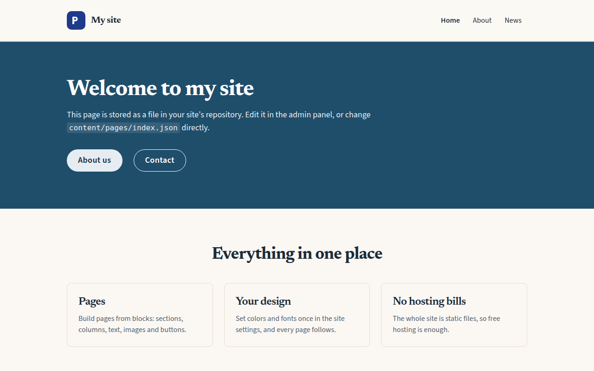

# Harbor, a Goodfellow theme

Deep harbor blue on warm sand, with a serif for headings, rounded cards and pill-shaped buttons. Calm and easy to read, in light and dark.



Harbor is [Goodfellow](https://github.com/goodfellow-cms/goodfellow-cms)'s own theme. Install it from your site's admin panel: **Site Settings → Themes**, search for Harbor, look at your pages with it, then **Install and publish**. You can change anything it sets afterwards in **Colors & fonts**, **Custom CSS** and **Header & Footer**, and updates to Harbor keep what you changed. Themes never update by themselves: when a new version is out, the Themes screen shows you your site with it first.

It's also the example to copy if you're making a theme of your own, and the rest of this page goes through how it's made.

## What's in it

A theme is an npm package with no code: settings and styles that Goodfellow copies into a site when an owner installs it. Harbor's package has these files:

| File | What it is |
|---|---|
| [`package.json`](package.json) | Its name, version, and the Goodfellow releases it works with |
| [`goodfellow-theme.json`](goodfellow-theme.json) | What the theme is, and which of its files to install |
| [`theme.css`](theme.css) | CSS for the touches its settings can't make |
| [`header.json`](header.json), [`footer.json`](footer.json) | A header and footer design |
| [`preview.png`](preview.png) | A picture of a site with it, for the Themes screen |
| [`test/theme.test.mjs`](test/theme.test.mjs) | Checks it as Goodfellow will when someone installs it |

### package.json

- **`name`** is `goodfellow-theme-<name>`, or `@you/goodfellow-theme-<name>`. The Themes screen lists only packages named this way.
- **`keywords`** include `goodfellow-theme`, which is how the Themes screen finds themes on npm.
- **`peerDependencies`** names the Goodfellow releases the theme works with, as a range on `@goodfellow-cms/core`, such as `>=0.6.0 <1.0.0`. A version is offered only to sites on a release in that range, and a version without one is never offered. Goodfellow's Updates screen warns owners when a newer Goodfellow release is outside it, so widen it once you've checked a new release.
- **`files`** lists everything the theme installs, since only those files are published.
- **`repository`** is where it's built from, which npm checks when it's published with provenance.

### goodfellow-theme.json

```json
{
  "version": 1,
  "title": "Harbor",
  "description": "…",
  "theme": { "colors": {}, "darkColors": {}, "fonts": {}, "radius": "0.625rem", "code": {}, "parts": {} },
  "css": "theme.css",
  "header": "header.json",
  "footer": "footer.json",
  "image": "preview.png"
}
```

**`theme`** has the same settings as a site's `content/site.json` (see [Content files](https://goodfellow-cms.github.io/goodfellow-cms/docs/content-files)). Leave out any you don't change, and the site keeps its own.

- **`colors`:** the site's eleven colors, which every block uses through its theme classes.
- **`darkColors`:** the same colors for dark mode. Harbor gives them but doesn't turn dark mode on, which is the owner's choice.
- **`fonts`:** two Google Fonts families, with their categories, so pages show something similar while they load.
- **`radius`:** how rounded corners are.
- **`code`:** the color schemes for code.
- **`parts`:** classes for blocks' named parts, such as `gf-card` and `gf-button`. They come after a block's own classes and before what an editor chooses for one block, so `rounded-full` changes every button's corners while an editor can still change any one of them. [Built-in blocks](https://goodfellow-cms.github.io/goodfellow-cms/docs/built-in-blocks#named-parts) lists every part's name. Parts' names never change, so a theme that uses them keeps working.

### theme.css

Goodfellow puts a theme's CSS at the start of the site's custom CSS, between two comments that mark it, so the owner's own CSS comes after it and wins. Write it with the site's color and font variables (`var(--primary)`, `var(--border)`, `var(--gf-font-heading)`), so it follows whatever colors an owner chooses, light and dark. Style blocks by their parts' names (`.gf-card-title`) and the page by its own (`.gf-header`, `.gf-main`, `.gf-footer`).

Load nothing from other sites, such as pictures or fonts, which would tell those sites who visits. The Themes screen lists anything a theme loads before an owner installs it. Google Fonts, the site's own media and data addresses are fine.

### header.json and footer.json

A header and footer as a site's `content/layout/header.json` and `footer.json` have them: [Puck](https://puckeditor.com) data, with the blocks' props. Owners choose whether to use them. Their blocks read the site's own name, logo, menus and contact details, so a new design never loses any of them.

- **Only these built-in blocks:** Section, Grid, Flex, Space, Heading, Text, Button, Contact details, Menu, Site name and logo, Search, Dark mode switch and Language switch. Others could load or run something on the site, so Goodfellow won't use a header or footer with any other block.
- **No pictures**, since they'd point to files the site doesn't have, and no `javascript:` or `data:` addresses, which make Goodfellow refuse the theme.
- **Menus by name:** Harbor's header shows the menu named `main` and its footer the one named `footer`, which sites made from Goodfellow's starter have. Showing the same menu twice on a page would confuse screen readers.
- Give every block an `id` of its own.

### preview.png

A picture of a site with the theme, about 1280 by 800 pixels. Harbor's is the home page of Goodfellow's starter site, built with the theme.

## Checking it

```sh
npm ci
npm test
```

`package-lock.json` names the Goodfellow release the test checks against, so every run checks the same one; Dependabot moves it on to newer ones in `devDependencies`' ranges, and `npm update` does the same by hand.

The test reads the theme with Goodfellow's own code and checks what installing it would: that `goodfellow-theme.json`, the header and the footer are valid, that the header and footer use only the blocks above, that the theme loads nothing from other sites, that its colors are easy to read in light and dark (as the admin panel's contrast check measures them), and that every part it gives classes is one a built-in block has. GitHub Actions runs it on every change ([`check.yml`](.github/workflows/check.yml)).

To see it on a site before publishing, apply it as installing it would with `planTheme()` from `@goodfellow-cms/core`, and run the site with `npm run dev`.

## Publishing a version

Every change that reaches the published theme needs a changeset: run `npx changeset`, choose patch, minor or major, and describe the change for the theme's users. It writes a file in `.changeset/`, which goes in the same pull request.

1. Run `npm run release:version`, which turns the changesets into a new `version` in `package.json` and an entry in `CHANGELOG.md`. Commit what it changes. Every release needs a new version: npm never lets one be published twice.
2. Publish a GitHub release whose tag is `v` and the version, such as `v1.1.0`.
3. [`publish.yml`](.github/workflows/publish.yml) checks the theme again and stages it on npm with [provenance](https://docs.npmjs.com/generating-provenance-statements), which the Themes screen shows owners: which repository and commit it was built from. A staged version isn't published: nobody can install it until a maintainer approves it. The run's page lists the digest of the file it staged.
4. Approve it from your computer, with npm 11.15 or later (`npm install --global npm@11`), signed in to npm (`npm login`): `npm stage list goodfellow-theme-harbor` lists what's waiting, with each one's id and digest. Compare the digest with the run's, then run `npm stage approve <id>`, which asks for your two-factor code and publishes it. To throw a staged version away instead, run `npm stage reject <id>`.

The workflow signs in to npm with [trusted publishing](https://docs.npmjs.com/trusted-publishers), so the repository holds no npm token, and it may only stage versions, so nothing reaches npm without a maintainer's two-factor authentication. Set it up once, with npm 11.15 or later:

```sh
npm trust github goodfellow-theme-harbor --file publish.yml --repo goodfellow-cms/goodfellow-theme-harbor --allow-stage-publish --yes
```

Without `--allow-publish`, npm refuses `npm publish` from the workflow. A package has one trusted publisher: if it already has one that may publish, find its id with `npm trust list goodfellow-theme-harbor` and remove it first with `npm trust revoke --id <id> goodfellow-theme-harbor`. npm drops a trusted publisher that hasn't staged anything within 2 days of being added, so add it shortly before a release. Then choose **Require two-factor authentication and disallow tokens** under the package's **Settings → Publishing access**. A new package's first version has to be published from a computer (`npm publish --access public`), since trusted publishing is set up in a package's settings.

The Themes screen offers a version once it's 3 days old, since most harmful versions of npm packages are found and removed by then.

## Making it easy to find

Call your theme's repository `goodfellow-theme-<name>` too, and give it the `goodfellow-theme` topic: on GitHub, the gear beside **About** on the repository's page; on GitLab, **Settings → General → Topics**.

## License

[MIT](LICENSE)
